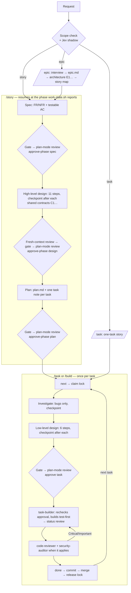

# Agent Skills

**Production-grade engineering skills for AI coding agents.**

Skills encode the workflows, quality gates, and best practices that senior engineers use when building software. These ones are packaged so AI agents follow them consistently across every phase of development.

> **This is a fork** of [addyosmani/agent-skills](https://github.com/addyosmani/agent-skills), maintained at [tung-dnt/agent-skills](https://github.com/tung-dnt/agent-skills). It adds:
> - design skills (`high-level-design`, `low-level-design`) that give each scope of work (epic, story, task) its own workflow
> - task notes in the Obsidian project-manager format, safe for parallel sessions, with git-lock claims and `/resume` after a closed session
> - a multi-agent `/build auto` that routes each piece of work to the cheapest model tier that can do it well
>
> See [What this fork adds](#what-this-fork-adds).

<a href="https://trendshift.io/repositories/25200" target="_blank"></a>


```
  DEFINE          PLAN           BUILD          VERIFY         REVIEW          SHIP
 ┌──────┐      ┌──────┐      ┌──────┐      ┌──────┐      ┌──────┐      ┌──────┐
 │ Idea │ ───▶ │ Spec │ ───▶ │ Code │ ───▶ │ Test │ ───▶ │  QA  │ ───▶ │  Go  │
 │Refine│      │  PRD │      │ Impl │      │Debug │      │ Gate │      │ Live │
 └──────┘      └──────┘      └──────┘      └──────┘      └──────┘      └──────┘
  /spec          /plan          /build        /test         /review       /ship
                              /resume
```

---

## Commands

14 slash commands that map to the development lifecycle. Each one activates the right skills automatically.

| What you're doing | Command | Key principle |
|-------------------|---------|---------------|
| Plan an epic or a new project | `/epic` | Intent, requirements, architecture, story map |
| Take a story to an approved plan | `/story` | Resumes at its current phase |
| Build one task end to end | `/task` | Claim → design note → your approval → subagents build and review |
| Stress-test a plan or decision | `/grill-me` | Settle every branch before acting |
| Define what to build | `/spec` | Spec before code |
| Plan how to build it | `/plan` | Small, atomic tasks |
| Build incrementally | `/build` | One slice at a time |
| Pick up after a closed session | `/resume` | State lives in files, not chat |
| Prove it works | `/test` | Tests are proof |
| Set the quality bar | `/constraints` | Decide it once, enforce it everywhere |
| Review before merge | `/review` | Improve code health |
| Audit web performance | `/webperf` | Measure before you optimize |
| Simplify the code | `/code-simplify` | Clarity over cleverness |
| Ship to production | `/ship` | Faster is safer |

In Claude Code these install as plugin commands. Where a built-in command has the same name, as `/review` does, use the namespaced form: `/agent-skills:review`.

Want fewer manual steps once the spec exists? **`/build auto`** generates the plan and implements every task in a single approved pass — you approve the plan once, then it runs autonomously. It removes the human stepping *between* tasks, not the verification: every task is still test-driven and committed individually, and it pauses on failures or risky steps.

Skills also activate automatically based on what you're doing — designing an API triggers `api-and-interface-design`, building UI triggers `frontend-ui-engineering`, and so on.

---

## What this fork adds

### A workflow for each scope of work

`/epic`, `/story`, and `/task` run these workflows. Every planning phase ends in a recorded approval, and nothing is built until `work-state.sh` confirms that approval still matches the files. They work with or without a tracker: a ticket key or URL is read as input, and without a tracker the repository's folders are the tracker.



| Phase | Command | Produces | Approval recorded as |
|---|---|---|---|
| Scope check | every command | epic, story, or task | Your confirmation when the scope looks wrong. Jev logs its guess but doesn't act on it |
| Epic | `/epic` | `epic.md`, `## Architecture` (`E1…`), story stubs | `summary.md`; its stories stay at phase `spec` until `/story` |
| Spec | `/story` | `spec.md` with `FR`/`NFR` ids | `spec_approved` in the story note's frontmatter |
| High-level design | `/story` | `## Design`, shared contracts `C1…` | `design_approved`, or recorded as skipped |
| Plan | `/story` | `plan.md` + `_tasks/*.md` | `plan_approved` (covers the plan and the list of task ids) |
| Task design | `/task` | the task's `## Design` (5–15 lines) | the task's `design_approved` (covers its description, design, and the text of each contract it cites) |
| Build | `task-builder` | code and tests, status `review` | — |
| Review → done | main session | `done`, merge, lock released | — |

**Every gate** ([references/approval-gate.md](references/approval-gate.md)):
1. A one-screen **catch-up summary** (Business context · Proposed fix fit · Root cause for bugs · Recommendation · Open decisions), saved to `[stories-dir]/[story-id]/summary.md` or the task note's `## Summary`.
2. **`grill-me` rounds** until nothing is open; each round is one `ask` dialog.
3. **In omp, a plan-mode review:** the agent asks you to turn plan mode on (Alt+Shift+P), submits the phase to omp's Plan Review, and your approval there (`keep`) is the go-ahead. `refine` sends it back with your feedback. Other hosts take the go-ahead as an answer to "Proceed?".
4. The go-ahead is **recorded** with `approve` / `approve-phase`.

Before the gate, `/story` and `/task` stop at a **step checkpoint** after the investigation and after every design step, so you approve the design piece by piece. `/build auto` and "don't stop" skip the checkpoints and pass one gate over every task design.

**What makes the tasks reliable:**
- **No building on a draft.** `phase` advances only on a recorded approval of an unchanged file. Editing an approved spec, design, or plan voids its approval.
- **No building on a stale contract.** Changing a contract voids every task design that cites it; `work-state.sh cites STORY C3` lists them so each goes through its gate again.
- **Checked twice.** The orchestrator runs `approved` before starting a builder, and the builder runs it again; if it fails, the builder reports `blocked`.
- **One owner per task.** The claim is a git lock (see below), so no two sessions, worktrees, or machines take the same task.
- **Safe parallel waves.** `/build auto` never puts two tasks that touch the same files in one wave; each task gets its own worktree.
- **Builder limits.** Test-first, commits only its own paths, never changes a shared contract, and stops with `blocked`, `failed`, or `needs-command` instead of guessing.
- **`done` means reviewed.** A task whose acceptance criteria pass goes to `review`; it is `done` only after code review (plus security review for auth or personal data) passes.
- **Resumable.** Status, `## Log` lines, claims, and worktrees are on disk; `/resume` rebuilds where each task stopped.
- **Measured before trusted.** An optional [Jev shadow pilot](hooks/JEV-SHADOW.md) logs TypeSafe Jev's answer at each checkpoint and scope check next to what actually happened, without acting on it, so a threshold for skipping checkpoints can be set from data (`jev.sh report`).

**Known weak spots:** a story stops about 13 times before planning and about 7 times per task, plus a keypress per plan-mode review; plan mode can only be turned on by you; an epic's approval lives only in its `summary.md`.

### Artifacts that are safe for parallel sessions

```
[stories-dir]/[story-id]/
  [story-id].md         Obsidian project note, made by `work-state.sh init-story`
  spec.md               requirements + ## Design          read-only after approval
  plan.md               task index, order, design refs     read-only after approval
  _tasks/[task-id].md   task note: status, design note, checklist, log   one writer: the claimer
```

Task and project notes use the note format of the Obsidian **project-manager** plugin ("dotpm"), so they show up in its boards when the store is a vault. Agents create and change them only through `work-state.sh` (`new-task`, `field`, `set`, `log`, `claim`, `approve`, `approve-phase`), and edit just the note body: the task description, `## Design`, `## Summary`, and the `## Checklist` ticks. Epics get a project note of their own (`[epics-dir]/[epic-id]/[epic-id].md`, made by `init-epic`); a story's project note links to its epic and records its phase approvals. An epic's architecture lives in its `epic.md` under `## Architecture`, with contract ids `E1…` that tasks can cite next to a story's `C1…`.

- **Where the notes live.** `work-state.sh root` resolves a store: `vault` or `repo`. When your Obsidian vault is configured, the vault is the store: `~/.config/agent-skills/config.json` (or `$AGENT_SKILLS_CONFIG`) holds `{"vault": "/abs/path"}` and, optionally, `projectsFolder`, and the omp-starter knowledge-base step writes it. Notes then go to `<vault>/<projectsFolder>/<vaultFolder>/stories` and `…/epics`; `projectsFolder` defaults to the project-manager plugin's setting, then `Projects`. Without a vault, the store is the repo: `docs/stories` and `docs/epics`. `.agent-skills.json` can force the choice with `"store": "vault" | "repo"` and name the vault folder with `"vaultFolder": "group/name"` (default: the repo name, so every worktree of a repo shares one folder). Its `storiesDir` and `epicsDir` keys still set the repo-store directories.
- **Claims are git locks.** `/build` claims a task with the ref `claim/[story-id]/[task-id]`. It is created atomically, and published with an "only if it doesn't exist yet" push when there's a remote. Two sessions, worktrees, or machines never take the same task or edit the same file. `claim` then sets the task to `in-progress` and records its work branch. A vault has a single copy of each note and no git history for it, so there `next` also waits for a dependency's claim to be released, which happens once its work is merged.
- **`/resume` after a closed session.** A read-only investigator rebuilds the ticked tree (epics → stories → tasks → checklist items), finds where each claimed task stopped (including uncommitted work in worktrees), and recommends the next step.
- **The repo-store location is resolved per project.** With no vault, `/spec`, `/plan`, and `/build` detect an existing layout and propose a location in `.agent-skills.json`. They write it only after you confirm. A repository that still has the old `tasks/` layout converts it with `work-state.sh migrate`.
- **`hooks/work-state.sh` does the git work and keeps the notes valid**, so the model doesn't have to: `root`, `configure`, `init-epic`, `init-story`, `new-task`, `path`, `field`, `set`, `log`, `phase`, `approve`, `approved`, `approve-phase`, `approved-phase`, `adopt-approvals`, `cites`, `next`, `claim`, `release`, `status`, `brief`, `migrate`, `hint`. It is covered by `hooks/work-state-test.sh`.
- **One startup hook.** The Claude Code plugin registers a SessionStart hook (`work-state.sh hint`) that prints a one-line `/resume` suggestion when claimed tasks exist, and nothing otherwise.
- **Claim locks are real branches.** Exclude `claim/**` from CI push triggers.

Full layout and protocol: [references/work-artifacts.md](references/work-artifacts.md).

### Multi-agent `/build auto` with model routing

`/build auto` runs as a coordinator. It picks and claims independent tasks, then gives each one to a `task-builder` subagent in its own worktree, running in parallel (default 3, max 5). A `code-reviewer` checks each diff, and `security-auditor` joins when a task touches auth or sensitive data. Reviewed tasks are merged, and their claims are released. The main thread keeps only short summaries.

| Tier | Model (Claude Code) | Runs |
|---|---|---|
| Deep | The model you selected for the main thread (`inherit`) | Dialogue with you, high-level design, design critique, security review, the retry after two failures |
| Balanced | `sonnet` | Task builders, low-level design notes, code review of a task diff |
| Fast | `haiku` | `/resume` investigation and other read-only work backed by scripts |

In an end-to-end run on 4 tasks, three builders ran concurrently and all 26 tests passed. The run cost **$3.37**: $1.31 for the coordinator and $2.06 for the Sonnet builders and reviewers. The main context peaked at 90k tokens. Routing rules: [references/model-routing.md](references/model-routing.md).

---

## Quick Start

**Fastest path — any agent, one command.** The open [skills CLI](https://github.com/vercel-labs/skills) installs into 70+ agents (Claude Code, Cursor, Codex, Copilot, Cline, and more):

```bash
npx skills add tung-dnt/agent-skills            # install all 28 skills
npx skills add tung-dnt/agent-skills --list     # browse before installing
```

Or grab individual skills:

```bash
npx skills add tung-dnt/agent-skills --skill code-review-and-quality   # five-axis review before merge
npx skills add tung-dnt/agent-skills --skill interview-me              # requirements interrogation, one question at a time
npx skills add tung-dnt/agent-skills --skill test-driven-development   # red-green-refactor, enforced
```

> **Installing one skill?** A per-skill `npx` install copies only
> `skills/<name>/`, not the repo-level `references/` directory. The skill still
> works, but paths to supplementary shared checklists are unavailable, and so is
> `hooks/work-state.sh` (the reference describes the manual git fallback). Use a
> whole-repo integration, clone the repository, or copy the needed checklist into
> a `references/` directory inside the installed skill. This portability gap is
> tracked in [#361](https://github.com/addyosmani/agent-skills/issues/361).

Prefer a native integration? Pick your tool below.

<details>
<summary><b>Claude Code (recommended)</b></summary>

**Marketplace install:**

```
/plugin marketplace add tung-dnt/agent-skills
/plugin install agent-skills@tung-agent-skills
```

**Updating:** the plugin version stays in step with upstream (0.6.x), so `/plugin update` can report "already at the latest version" after new commits. Reinstall to pick them up:

```bash
claude plugin marketplace update tung-agent-skills
claude plugin uninstall agent-skills@tung-agent-skills
claude plugin install agent-skills@tung-agent-skills
```

> **SSH errors?** The marketplace clones repos via SSH. If you don't have SSH keys set up on GitHub, either [add your SSH key](https://docs.github.com/en/authentication/connecting-to-github-with-ssh/adding-a-new-ssh-key-to-your-github-account) or use the full HTTPS URL to force HTTPS cloning during the marketplace-add step:
> ```bash
> /plugin marketplace add https://github.com/tung-dnt/agent-skills.git
> /plugin install agent-skills@tung-agent-skills
> ```
>
> If `/plugin install` still fails with `git@github.com: Permission denied (publickey)` on Windows or macOS, the recommended workaround is to configure Git once to rewrite GitHub SSH URLs to HTTPS for subprocess clones:
> ```bash
> git config --global url."https://github.com/".insteadOf git@github.com:
> ```

**Local / development:**

```bash
git clone https://github.com/tung-dnt/agent-skills.git
claude --plugin-dir /path/to/agent-skills
```

</details>

<details>
<summary><b>Cursor</b></summary>

Put workflow skills under `.cursor/skills/` (sync from `agent-skills/skills/`) and short policies in `.cursor/rules/*.mdc` — do not paste full skills into rules. Both directories live in your project; this repo does not ship a `.cursor/` folder. See [docs/cursor-setup.md](docs/cursor-setup.md).

</details>

<details>
<summary><b>Antigravity CLI</b></summary>

Install as a native plugin for skills and subagents. In affected Antigravity CLI releases, legacy command TOMLs are reported as converted but their wrapper commands are not discoverable; invoke the underlying namespaced skills directly. See [docs/antigravity-setup.md](docs/antigravity-setup.md#lifecycle-workflows-and-command-compatibility).

**Install from the repo:**

```bash
agy plugin install https://github.com/tung-dnt/agent-skills.git
```

**Install from a local clone:**

```bash
git clone https://github.com/tung-dnt/agent-skills.git
agy plugin install ./agent-skills
```

</details>

<details>
<summary><b>Gemini CLI</b></summary>

Install as native skills for auto-discovery, or add to `GEMINI.md` for persistent context. See [docs/gemini-cli-setup.md](docs/gemini-cli-setup.md).

**Install from the repo:**

```bash
gemini skills install https://github.com/tung-dnt/agent-skills.git --path skills
```

**Install from a local clone:**

```bash
gemini skills install ./agent-skills/skills/
```

</details>

<details>
<summary><b>Windsurf</b></summary>

Add skill contents to your Windsurf rules configuration. See [docs/windsurf-setup.md](docs/windsurf-setup.md).

</details>

<details>
<summary><b>OpenCode</b></summary>

Copy skills to `.opencode/skills/` (or `~/.config/opencode/skills/`), add a project-local `AGENTS.md`, and use the built-in `skill` tool for agent-driven execution. Optional slash commands can be added under `.opencode/commands/`.

See [docs/opencode-setup.md](docs/opencode-setup.md).

</details>

<details>
<summary><b>GitHub Copilot</b></summary>

Use agent definitions from `agents/` as Copilot personas and skill content in `.github/copilot-instructions.md`. The lifecycle slash commands (`/spec`, `/plan`, `/build`, `/test`, `/review`, `/ship`) are Claude Code commands and do not appear in Copilot; invoke the skills by name (`/spec-driven-development`, …) instead. See [docs/copilot-setup.md](docs/copilot-setup.md).

Using the standalone `copilot` CLI? Install it as a plugin — see [docs/copilot-cli-setup.md](docs/copilot-cli-setup.md).

</details>

<details>
  <summary><b>Kiro IDE & CLI </b></summary>
  Skills for Kiro reside under ".kiro/skills/" and can be stored under Project or Global level. Kiro also supports Agents.md. See Kiro docs at https://kiro.dev/docs/skills/
</details>

<details>
<summary><b>Codex</b></summary>

Install as a native Codex plugin (Codex CLI v0.122+):

```bash
codex plugin marketplace add tung-dnt/agent-skills
codex plugin add agent-skills@agent-skills
```

The first command registers the marketplace; the second installs the plugin. Codex reads the root `skills/` directory directly through `.codex-plugin/plugin.json`. Once installed, invoke skills in chat using `@` (e.g., `@spec-driven-development`). See [docs/codex-setup.md](docs/codex-setup.md) for local installation and troubleshooting.

</details>

<details>
<summary><b>Command Code</b></summary>

Install natively with the built-in `cmd skills` command. Command Code clones the repo, discovers every `SKILL.md`, and installs into `.commandcode/skills/`:

```bash
cmd skills add tung-dnt/agent-skills            # pick skills to install (project)
cmd skills add tung-dnt/agent-skills --global   # install for all projects (~/.commandcode/skills/)
cmd skills add tung-dnt/agent-skills -s spec-driven-development  # install a specific skill
```

Installed skills show up in the TUI slash menu, e.g. `/spec-driven-development`. See [docs/commandcode-setup.md](docs/commandcode-setup.md).

</details>

<details>
<summary><b>Other Agents</b></summary>

Skills are plain Markdown - they work with any agent that accepts system prompts or instruction files. See [docs/getting-started.md](docs/getting-started.md). Hosts that install the pack but aren't listed above are in [docs/other-hosts.md](docs/other-hosts.md).

</details>


---

## Adoption

Already installed? How you roll the pack out depends on your codebase. The **[Adoption Guide](docs/adoption-guide.md)** covers two paths: the full lifecycle from day one for a greenfield project, or an incremental, verification-first rollout for an established codebase.

---

## All 28 Skills

The commands above are entry points. The pack includes 28 skills total — 27 lifecycle skills plus the `using-agent-skills` meta-skill. Each skill is a structured workflow with steps, verification gates, and anti-rationalization tables. You can also reference any skill directly.

### Meta - Discover which skill applies

| Skill | What It Does | Use When |
|-------|-------------|----------|
| [using-agent-skills](skills/using-agent-skills/SKILL.md) | Maps incoming work to the right skill workflow and defines shared operating rules | Starting a session or deciding which skill applies |

### Define - Clarify what to build

| Skill | What It Does | Use When |
|-------|-------------|----------|
| [interview-me](skills/interview-me/SKILL.md) | One-question-at-a-time interview that extracts what the user actually wants instead of what they think they should want, until ~95% confidence | The ask is underspecified, or the user invokes "interview me" / "grill me" |
| [grill-me](skills/grill-me/SKILL.md) | Stress-tests a plan, decision, or idea you already have: rounds of numbered questions with recommended answers, walked as a design tree until every branch is settled | You want your thinking challenged before you act on it ("grill me") |
| [idea-refine](skills/idea-refine/SKILL.md) | Structured divergent/convergent thinking to turn vague ideas into concrete proposals | You have a rough concept that needs exploration |
| [spec-driven-development](skills/spec-driven-development/SKILL.md) | Write a PRD covering objectives, commands, structure, code style, testing, and boundaries before any code | Starting a new project, feature, or significant change |
| [constraint-driven-development](skills/constraint-driven-development/SKILL.md) | Interviews you for a quality bar with sane default thresholds, writes CONSTRAINTS.md, places each check by cost, and catches agents silencing checks or skipping tests to get green | No standards are written down, or an agent is producing more than anyone reads |

### Plan - Break it down

| Skill | What It Does | Use When |
|-------|-------------|----------|
| [high-level-design](skills/high-level-design/SKILL.md) | Turn approved requirements into a system shape (components, flows, data ownership, NFR mechanisms) and the shared contracts tasks depend on | A story or feature adds or reshapes components, or several tasks will share a contract |
| [planning-and-task-breakdown](skills/planning-and-task-breakdown/SKILL.md) | Decompose specs into small, verifiable tasks with acceptance criteria and dependency ordering | You have a spec and need implementable units |

### Build - Write the code

| Skill | What It Does | Use When |
|-------|-------------|----------|
| [low-level-design](skills/low-level-design/SKILL.md) | Write a short design note for one task: edge contracts, invariants, failure branches, security check, and the test list | A planned task is next and its edge cases and error handling aren't decided |
| [incremental-implementation](skills/incremental-implementation/SKILL.md) | Thin vertical slices - implement, test, verify, commit. Feature flags, safe defaults, rollback-friendly changes | Any change touching more than one file |
| [test-driven-development](skills/test-driven-development/SKILL.md) | Red-Green-Refactor, test pyramid (80/15/5), test sizes, DAMP over DRY, Beyonce Rule, browser testing | Implementing logic, fixing bugs, or changing behavior |
| [context-engineering](skills/context-engineering/SKILL.md) | Feed agents the right information at the right time - rules files, context packing, MCP integrations | Starting a session, switching tasks, or when output quality drops |
| [source-driven-development](skills/source-driven-development/SKILL.md) | Ground every framework decision in official documentation - verify, cite sources, flag what's unverified | You want authoritative, source-cited code for any framework or library |
| [doubt-driven-development](skills/doubt-driven-development/SKILL.md) | Adversarial fresh-context review of every non-trivial decision in-flight - CLAIM → EXTRACT → DOUBT → RECONCILE → STOP, with optional user-authorized cross-model escalation | Stakes are high (production, security, irreversible), working in unfamiliar code, or a confident output is cheaper to verify now than to debug later |
| [frontend-ui-engineering](skills/frontend-ui-engineering/SKILL.md) | Component architecture, design systems, state management, responsive design, WCAG 2.1 AA accessibility | Building or modifying user-facing interfaces |
| [api-and-interface-design](skills/api-and-interface-design/SKILL.md) | Contract-first design, Hyrum's Law, One-Version Rule, error semantics, boundary validation | Designing APIs, module boundaries, or public interfaces |

### Verify - Prove it works

| Skill | What It Does | Use When |
|-------|-------------|----------|
| [browser-testing-with-devtools](skills/browser-testing-with-devtools/SKILL.md) | Chrome DevTools MCP for live runtime data - DOM inspection, console logs, network traces, performance profiling | Building or debugging anything that runs in a browser |
| [debugging-and-error-recovery](skills/debugging-and-error-recovery/SKILL.md) | Five-step triage: reproduce, localize, reduce, fix, guard. Stop-the-line rule, safe fallbacks | Tests fail, builds break, or behavior is unexpected |

### Review - Quality gates before merge

| Skill | What It Does | Use When |
|-------|-------------|----------|
| [code-review-and-quality](skills/code-review-and-quality/SKILL.md) | Five-axis review, change sizing (~100 lines), severity labels (Nit/Optional/FYI), review speed norms, splitting strategies | Before merging any change |
| [code-simplification](skills/code-simplification/SKILL.md) | Chesterton's Fence, Rule of 500, reduce complexity while preserving exact behavior | Code works but is harder to read or maintain than it should be |
| [security-and-hardening](skills/security-and-hardening/SKILL.md) | OWASP Top 10 prevention, auth patterns, secrets management, dependency auditing, three-tier boundary system | Handling user input, auth, data storage, or external integrations |
| [performance-optimization](skills/performance-optimization/SKILL.md) | Measure-first approach - Core Web Vitals targets, profiling workflows, bundle analysis, anti-pattern detection | Performance requirements exist or you suspect regressions |

### Ship - Deploy with confidence

| Skill | What It Does | Use When |
|-------|-------------|----------|
| [git-workflow-and-versioning](skills/git-workflow-and-versioning/SKILL.md) | Trunk-based development, atomic commits, change sizing (~100 lines), the commit-as-save-point pattern | Making any code change (always) |
| [ci-cd-and-automation](skills/ci-cd-and-automation/SKILL.md) | Shift Left, Faster is Safer, feature flags, quality gate pipelines, failure feedback loops | Setting up or modifying build and deploy pipelines |
| [deprecation-and-migration](skills/deprecation-and-migration/SKILL.md) | Code-as-liability mindset, compulsory vs advisory deprecation, migration patterns, zombie code removal | Removing old systems, migrating users, or sunsetting features |
| [documentation-and-adrs](skills/documentation-and-adrs/SKILL.md) | Architecture Decision Records, API docs, inline documentation standards - document the *why* | Making architectural decisions, changing APIs, or shipping features |
| [observability-and-instrumentation](skills/observability-and-instrumentation/SKILL.md) | Structured logging, RED metrics, OpenTelemetry tracing, symptom-based alerting - instrument as you build | Adding telemetry, or shipping anything that runs in production |
| [shipping-and-launch](skills/shipping-and-launch/SKILL.md) | Pre-launch checklists, feature flag lifecycle, staged rollouts, rollback procedures, monitoring setup | Preparing to deploy to production |

---

## Agent Personas

Pre-configured specialist personas for targeted reviews, plus two workers that the slash commands delegate to. Each agent declares its model tier (see [model-routing.md](references/model-routing.md)):

| Agent | Role | Model | Perspective |
|-------|------|-------|-------------|
| [code-reviewer](agents/code-reviewer.md) | Senior Staff Engineer | sonnet | Five-axis code review with "would a staff engineer approve this?" standard |
| [test-engineer](agents/test-engineer.md) | QA Specialist | sonnet | Test strategy, coverage analysis, and the Prove-It pattern |
| [security-auditor](agents/security-auditor.md) | Security Engineer | inherit | Vulnerability detection, threat modeling, OWASP assessment |
| [web-performance-auditor](agents/web-performance-auditor.md) | Web Performance Engineer | sonnet | Core Web Vitals audit with Quick/Deep modes and a metric-honesty rule; run it via `/webperf` |
| [task-builder](agents/task-builder.md) | Implementer | sonnet | Builds one claimed task test-first in its own worktree; used by `/build auto` |
| [state-investigator](agents/state-investigator.md) | Read-only investigator | haiku | Reconstructs where in-progress work stopped; used by `/resume` |

See [docs/agents.md](docs/agents.md) for the decision matrix, orchestration rules, and how personas compose with skills and slash commands.

---

## Reference Checklists

Quick-reference material that skills pull in when needed:

| Reference | Covers |
|-----------|--------|
| [definition-of-done.md](references/definition-of-done.md) | Project-wide standing bar every change clears, contrasted with per-task acceptance criteria |
| [testing-patterns.md](references/testing-patterns.md) | Test structure, naming, mocking, React/API/E2E examples, anti-patterns (JavaScript/TypeScript) |
| [security-checklist.md](references/security-checklist.md) | Pre-commit checks, auth, input validation, headers, CORS, OWASP Top 10 |
| [performance-checklist.md](references/performance-checklist.md) | Core Web Vitals targets, frontend/backend checklists, measurement commands |
| [accessibility-checklist.md](references/accessibility-checklist.md) | Keyboard nav, screen readers, visual design, ARIA, testing tools |
| [observability-checklist.md](references/observability-checklist.md) | On-call questions, structured logging, RED/USE metrics, tracing, symptom-based alerting, pre-launch gate |
| [orchestration-patterns.md](references/orchestration-patterns.md) | Endorsed multi-persona orchestration patterns, anti-patterns, and the "personas don't invoke personas" rule |
| [work-artifacts.md](references/work-artifacts.md) | Per-story layout, task notes, the git-lock claim protocol, store resolution (vault or repo), progress view, and resuming |
| [approval-gate.md](references/approval-gate.md) | The one gate before work starts: catch-up summary format, `grill-me` rounds, explicit go-ahead, and where each gate sits |
| [model-routing.md](references/model-routing.md) | Model tiers, what gets delegated at each scope, the subagent output contract, parallel fan-out, and escalation |

---

## How Skills Work

Every skill follows a consistent anatomy:

```
┌─────────────────────────────────────────────────┐
│  SKILL.md                                       │
│                                                 │
│  ┌─ Frontmatter ─────────────────────────────┐  │
│  │ name: lowercase-hyphen-name               │  │
│  │ description: Guides agents through [task].│  │
│  │              Use when…                    │  │
│  └───────────────────────────────────────────┘  │                                                                                                
│  Overview         → What this skill does        │
│  When to Use      → Triggering conditions       │
│  Process          → Step-by-step workflow       │
│  Rationalizations → Excuses + rebuttals         │
│  Red Flags        → Signs something's wrong     │
│  Verification     → Evidence requirements       │
└─────────────────────────────────────────────────┘
```

**Key design choices:**

- **Process, not prose.** Skills are workflows agents follow, not reference docs they read. Each has steps, checkpoints, and exit criteria.
- **Anti-rationalization.** Every skill includes a table of common excuses agents use to skip steps (e.g., "I'll add tests later") with documented counter-arguments.
- **Verification is non-negotiable.** Every skill ends with evidence requirements - tests passing, build output, runtime data. "Seems right" is never sufficient.
- **Progressive disclosure.** The `SKILL.md` is the entry point. Supporting references load only when needed, keeping token usage minimal.

---

## Project Structure

The portable core stays in shared directories. Host-specific paths are native discovery conventions, not branding aliases; renaming or merging them would break the tools that scan those exact locations.

| Layer / consumer | Repository paths | Purpose |
|---|---|---|
| Shared workflow core | `skills/` (28 skills) | Portable `SKILL.md` workflows used by every integration |
| Shared review material | `agents/` (6 agents), `references/` (10 references) | Specialist reviewers, delegated workers, and pack-level references carried by whole-repo installs |
| Claude Code adapter | `.claude/commands/` (14 commands), `.claude-plugin/`, `hooks/` | Slash-command wrappers, marketplace metadata, lifecycle hooks, and `work-state.sh` |
| Gemini CLI adapter | `.gemini/commands/` (14 commands) | Gemini-native TOML command wrappers |
| Antigravity CLI adapter | `commands/` (14 commands), `plugin.json` | Legacy TOML wrappers and the root plugin manifest; see the [known wrapper limitation](docs/antigravity-setup.md#lifecycle-workflows-and-command-compatibility) |
| Codex adapter | `.codex-plugin/`, `.agents/plugins/` | Codex plugin metadata and marketplace registration; Codex consumes `skills/` directly |
| GitHub Copilot CLI adapter | `plugin.json` | Root plugin metadata; Copilot CLI discovers `skills/` by convention and does not register the lifecycle wrappers |
| Contributor tooling | `scripts/` (13 scripts), `evals/` (28 case files), `.github/workflows/` | Validation, routing evals, and CI |
| Documentation | `docs/` | Universal guidance and per-tool setup guides |

Tools without a checked-in adapter directory install or copy the shared `skills/` core into their own native location. The [Quick Start](#quick-start) links the setup guide for each supported host.

---

## Why Agent Skills?

AI coding agents default to the shortest path - which often means skipping specs, tests, security reviews, and the practices that make software reliable. Agent Skills gives agents structured workflows that enforce the same discipline senior engineers bring to production code.

Each skill encodes hard-won engineering judgment: *when* to write a spec, *what* to test, *how* to review, and *when* to ship. These aren't generic prompts - they're the kind of opinionated, process-driven workflows that separate production-quality work from prototype-quality work.

Skills bake in best practices from Google's engineering culture — including concepts from [Software Engineering at Google](https://abseil.io/resources/swe-book) and Google's [engineering practices guide](https://google.github.io/eng-practices/). You'll find Hyrum's Law in API design, the Beyonce Rule and test pyramid in testing, change sizing and review speed norms in code review, Chesterton's Fence in simplification, trunk-based development in git workflow, Shift Left and feature flags in CI/CD, and a dedicated deprecation skill treating code as a liability. These aren't abstract principles — they're embedded directly into the step-by-step workflows agents follow.

---

## How it compares

Wondering how this stacks up against [Superpowers](https://github.com/obra/superpowers) or [Matt Pocock's skills](https://github.com/mattpocock/skills)? See **[docs/comparison.md](docs/comparison.md)** for an honest, side-by-side look at how the three are shaped differently and when to reach for each — including a link to a controlled [head-to-head experiment](https://www.linkedin.com/pulse/superpowers-vs-agent-skills-faster-shipping-safer-reasoning-om-mishra-dzakf/).

---

## Contributing

Skills should be **specific** (actionable steps, not vague advice), **verifiable** (clear exit criteria with evidence requirements), **battle-tested** (based on real workflows), and **minimal** (only what's needed to guide the agent).

See [docs/skill-anatomy.md](docs/skill-anatomy.md) for the format specification, [CONTRIBUTING.md](CONTRIBUTING.md) for guidelines, and [docs/advanced-per-agent-configuration.md](docs/advanced-per-agent-configuration.md) for applying model routing, tool restrictions, and other per-agent runtime controls without breaking the portable `SKILL.md` frontmatter.

---

## Team

agent-skills is built and maintained by:

| | Name | GitHub | Role |
|---|------|--------|------|
|  | **Addy Osmani** | [@addyosmani](https://github.com/addyosmani) | Creator |
|  | **Federico Bartoli** | [@federicobartoli](https://github.com/federicobartoli) | Collaborator |
|  | **Joan León** | [@nucliweb](https://github.com/nucliweb) | Collaborator |

This fork is maintained by [@tung-dnt](https://github.com/tung-dnt).

---

## License

MIT - use these skills in your projects, teams, and tools.
