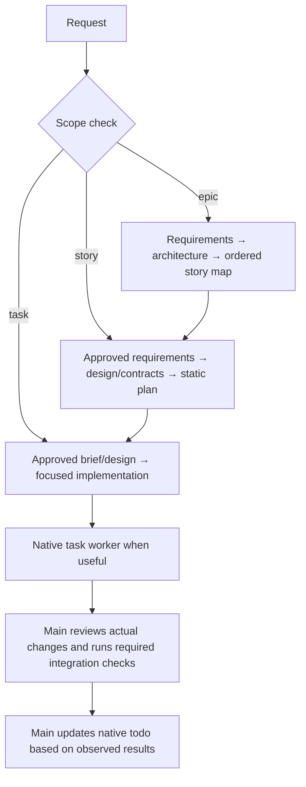

# Agent Skills

**Production-grade engineering skills for AI coding agents.**

Skills encode the workflows, quality gates, and best practices that senior engineers use when building software. These ones are packaged so AI agents follow them consistently across every phase of development.

> **This is a fork** of [addyosmani/agent-skills](https://github.com/addyosmani/agent-skills), maintained at [tung-dnt/agent-skills](https://github.com/tung-dnt/agent-skills). It adds:
> - high- and low-level design skills with explicit requirements, contract, and user-approval workflows
> - a native-first task workflow: native todo is the main session's progress list, native task runs workers, and static artifacts carry the handoff
> - verification evidence for registered work without advertising unregistered work as hard-verified
>
> See [What this fork adds](#what-this-fork-adds).

<a href="https://trendshift.io/repositories/25200" target="_blank"></a>


```
  DEFINE          PLAN           BUILD          VERIFY         REVIEW          SHIP
 ┌──────┐      ┌──────┐      ┌──────┐      ┌──────┐      ┌──────┐      ┌──────┐
 │ Idea │ ───▶ │ Spec │ ───▶ │ Code │ ───▶ │ Test │ ───▶ │  QA  │ ───▶ │  Go  │
 │Refine│      │  PRD │      │ Impl │      │Debug │      │ Gate │      │ Live │
 └──────┘      └──────┘      └──────┘      └──────┘      └──────┘      └──────┘
  /spec          /plan          /build        /test         /review       /ship
                              /resume
```

---

## Unreleased

- **Breaking:** lifecycle workflows no longer use task-note status, project claims, or a task-store CLI. Existing board data is not migrated or deleted automatically; see the [adoption guide](docs/adoption-guide.md).
- **Added:** opt-in Git-candidate verification through the native `verification` tool and `/verification`, with user-approved scope/checks, real child outcomes, resource-generation freshness, and protected native todo transitions.
- **Preserved:** requirement/design briefs, user approval gates, Jev routing, knowledge/memory integrations, and unrelated hooks.

## Commands

14 slash commands that map to the development lifecycle. Each one activates the right skills automatically.

| What you're doing | Command | Key principle |
|-------------------|---------|---------------|
| Plan an epic or a new project | `/epic` | Intent, requirements, architecture, story map |
| Take a story through an approved plan | `/story` | Requirements → design → static plan |
| Build one task end to end | `/task` | User gate → approved LLD for every planned task → test-first build → review |
| Stress-test a plan or decision | `/grill-me` | Settle every branch before acting |
| Define what to build | `/spec` | Spec before code |
| Plan how to build it | `/plan` | Small, ordered worker briefs |
| Build incrementally | `/build` | Main owns order and file ownership; native task workers execute |
| Resume available work | `/resume` | Current native session + accessible static artifacts |
| Prove it works | `/test` | Tests are proof |
| Set the quality bar | `/constraints` | Decide it once, enforce it everywhere |
| Review before merge | `/review` | Improve code health |
| Audit web performance | `/webperf` | Measure before you optimize |
| Simplify the code | `/code-simplify` | Clarity over cleverness |
| Ship to production | `/ship` | Faster is safer |

In Claude Code these install as plugin commands. Where a built-in command has the same name, as `/review` does, use the namespaced form: `/agent-skills:review`.

`/build` implements approved work using native task workers when useful. The main session owns the current native todo, user gates, task order, and exact file ownership. Every worker receives static artifact paths and explicit acceptance criteria; workers run focused checks, and one main integration owner runs required full, integration, and runtime checks at stable boundaries. See [docs/native-task-workflow.md](docs/native-task-workflow.md).

Skills also activate automatically based on what you're doing — designing an API triggers `api-and-interface-design`, building UI triggers `frontend-ui-engineering`, and so on.

---

## What this fork adds

### A workflow for each scope of work

`/epic`, `/story`, `/task`, `/build`, and `/resume` combine explicit user gates with native progress and static artifact handoffs:



| Phase | Main artifact/progress | Approval/evidence |
|---|---|---|
| Requirements | Static spec with testable `FR`/`NFR` criteria | Explicit user gate |
| Design | Static architecture/contracts with stable IDs | Explicit user gate and fresh-context critique where required |
| Plan | Static ordered plan and bounded worker briefs | Explicit user gate |
| Execution | Native todo for this main session; native task for worker execution | Worker output is not test proof |
| Verification | Candidate-scoped receipts for registered work | `begin`, `run`, `status`, `complete`, `cancel`; approval remains user-facing |
| Integration | Main-owned required full, integration, and runtime/browser checks | Report only observed results |

**Every planning/design gate** follows [references/approval-gate.md](references/approval-gate.md): show a catch-up summary and the relevant artifact, grill open decisions, then wait for explicit user approval. Do not treat a todo item, task completion, imported note, or model argument as approval.

**What makes the handoff reliable:**
- **One mutable progress owner.** The main session uses native todo; no Markdown task-status copy, vault task store, or replacement project JSON board is created.
- **Static context.** Specs, designs, plans, decisions, and worker briefs are passed by absolute path. They are not edited as a second progress tracker.
- **Main-owned coordination.** The main session chooses order, dependencies, and one owner per shared file. There is no project-wide claim, lock, automatic DAG readiness, or conflict-detection guarantee.
- **Bounded workers.** Native task execution receives one approved task and explicit allowed paths, runs focused checks, and reports exact evidence and unrun checks.
- **Per-task design gate.** Every task from a written plan gets a user-approved low-level design before code, even if mechanical; concise notes and explicit repo-slice approvals are allowed, silent skips are not.
- **User-only approval.** Policy/scope approval is obtained through the supported user-facing interaction, never a model-supplied flag.
- **Evidence is distinct.** Registered work uses the verification interface; `complete` records evidence and does not set todo progress. Native task completion is not proof. Unregistered work is not advertised as hard-verified.
- **Honest resume.** `/resume` uses current native session state, accessible worker output, static artifacts, and repository state; it cannot promise recovery of another session's checklist or ownership.
- **Quality gates remain.** Workers run focused checks. The main integration owner runs required full-suite and project-required runtime checks at stable boundaries without waiving quality criteria.
- **Other capabilities remain independent.** The Jev shadow pilot, skill routing, knowledge-base/memory behavior, and unrelated hooks keep their existing roles.

Details: [Native Task Workflow](docs/native-task-workflow.md), [Work Artifacts and Native Progress](references/work-artifacts.md), and [Approval Gate](references/approval-gate.md).

---

## Quick Start

**Fastest path — any agent, one command.** The open [skills CLI](https://github.com/vercel-labs/skills) installs into 70+ agents (Claude Code, Cursor, Codex, Copilot, Cline, and more):

```bash
npx skills add tung-dnt/agent-skills            # install all 28 skills
npx skills add tung-dnt/agent-skills --list     # browse before installing
```

Or grab individual skills:

```bash
npx skills add tung-dnt/agent-skills --skill code-review-and-quality   # five-axis review before merge
npx skills add tung-dnt/agent-skills --skill interview-me              # requirements interrogation in short rounds of guessed questions
npx skills add tung-dnt/agent-skills --skill test-driven-development   # red-green-refactor, enforced
```

> **Installing one skill?** A per-skill `npx` install copies only
> `skills/<name>/`; shared references are unavailable unless you add them or
> install the whole repository. The skill can still guide static specs and
> designs, but does not add OMP's native todo/task or verification tools. Do not
> assume project-wide task state, claims, or verification from a per-skill install.
> See [#361](https://github.com/addyosmani/agent-skills/issues/361) for the
> supplementary-reference portability gap.

Prefer a native integration? Pick your tool below.

<details>
<summary><b>Claude Code (recommended)</b></summary>

**Marketplace install:**

```
/plugin marketplace add tung-dnt/agent-skills
/plugin install agent-skills@tung-agent-skills
```

**Updating:** the plugin version stays in step with upstream (0.6.x), so `/plugin update` can report "already at the latest version" after new commits. Reinstall to pick them up:

```bash
claude plugin marketplace update tung-agent-skills
claude plugin uninstall agent-skills@tung-agent-skills
claude plugin install agent-skills@tung-agent-skills
```

> **SSH errors?** The marketplace clones repos via SSH. If you don't have SSH keys set up on GitHub, either [add your SSH key](https://docs.github.com/en/authentication/connecting-to-github-with-ssh/adding-a-new-ssh-key-to-your-github-account) or use the full HTTPS URL to force HTTPS cloning during the marketplace-add step:
> ```bash
> /plugin marketplace add https://github.com/tung-dnt/agent-skills.git
> /plugin install agent-skills@tung-agent-skills
> ```
>
> If `/plugin install` still fails with `git@github.com: Permission denied (publickey)` on Windows or macOS, the recommended workaround is to configure Git once to rewrite GitHub SSH URLs to HTTPS for subprocess clones:
> ```bash
> git config --global url."https://github.com/".insteadOf git@github.com:
> ```

**Local / development:**

```bash
git clone https://github.com/tung-dnt/agent-skills.git
claude --plugin-dir /path/to/agent-skills
```

</details>

<details>
<summary><b>Cursor</b></summary>

Put workflow skills under `.cursor/skills/` (sync from `agent-skills/skills/`) and short policies in `.cursor/rules/*.mdc` — do not paste full skills into rules. Both directories live in your project; this repo does not ship a `.cursor/` folder. See [docs/cursor-setup.md](docs/cursor-setup.md).

</details>

<details>
<summary><b>Antigravity CLI</b></summary>

Install as a native plugin for skills and subagents. In affected Antigravity CLI releases, legacy command TOMLs are reported as converted but their wrapper commands are not discoverable; invoke the underlying namespaced skills directly. See [docs/antigravity-setup.md](docs/antigravity-setup.md#lifecycle-workflows-and-command-compatibility).

**Install from the repo:**

```bash
agy plugin install https://github.com/tung-dnt/agent-skills.git
```

**Install from a local clone:**

```bash
git clone https://github.com/tung-dnt/agent-skills.git
agy plugin install ./agent-skills
```

</details>

<details>
<summary><b>Gemini CLI</b></summary>

Install as native skills for auto-discovery, or add to `GEMINI.md` for persistent context. See [docs/gemini-cli-setup.md](docs/gemini-cli-setup.md).

**Install from the repo:**

```bash
gemini skills install https://github.com/tung-dnt/agent-skills.git --path skills
```

**Install from a local clone:**

```bash
gemini skills install ./agent-skills/skills/
```

</details>

<details>
<summary><b>Windsurf</b></summary>

Add skill contents to your Windsurf rules configuration. See [docs/windsurf-setup.md](docs/windsurf-setup.md).

</details>

<details>
<summary><b>OpenCode</b></summary>

Copy skills to `.opencode/skills/` (or `~/.config/opencode/skills/`), add a project-local `AGENTS.md`, and use the built-in `skill` tool for agent-driven execution. Optional slash commands can be added under `.opencode/commands/`.

See [docs/opencode-setup.md](docs/opencode-setup.md).

</details>

<details>
<summary><b>GitHub Copilot</b></summary>

Use agent definitions from `agents/` as Copilot personas and skill content in `.github/copilot-instructions.md`. The lifecycle slash commands (`/spec`, `/plan`, `/build`, `/test`, `/review`, `/ship`) are Claude Code commands and do not appear in Copilot; invoke the skills by name (`/spec-driven-development`, …) instead. See [docs/copilot-setup.md](docs/copilot-setup.md).

Using the standalone `copilot` CLI? Install it as a plugin — see [docs/copilot-cli-setup.md](docs/copilot-cli-setup.md).

</details>

<details>
  <summary><b>Kiro IDE & CLI </b></summary>
  Skills for Kiro reside under ".kiro/skills/" and can be stored under Project or Global level. Kiro also supports Agents.md. See Kiro docs at https://kiro.dev/docs/skills/
</details>

<details>
<summary><b>Codex</b></summary>

Install as a native Codex plugin (Codex CLI v0.122+):

```bash
codex plugin marketplace add tung-dnt/agent-skills
codex plugin add agent-skills@agent-skills
```

The first command registers the marketplace; the second installs the plugin. Codex reads the root `skills/` directory directly through `.codex-plugin/plugin.json`. Once installed, invoke skills in chat using `@` (e.g., `@spec-driven-development`). See [docs/codex-setup.md](docs/codex-setup.md) for local installation and troubleshooting.

</details>

<details>
<summary><b>Command Code</b></summary>

Install natively with the built-in `cmd skills` command. Command Code clones the repo, discovers every `SKILL.md`, and installs into `.commandcode/skills/`:

```bash
cmd skills add tung-dnt/agent-skills            # pick skills to install (project)
cmd skills add tung-dnt/agent-skills --global   # install for all projects (~/.commandcode/skills/)
cmd skills add tung-dnt/agent-skills -s spec-driven-development  # install a specific skill
```

Installed skills show up in the TUI slash menu, e.g. `/spec-driven-development`. See [docs/commandcode-setup.md](docs/commandcode-setup.md).

</details>

<details>
<summary><b>Other Agents</b></summary>

Skills are plain Markdown - they work with any agent that accepts system prompts or instruction files. See [docs/getting-started.md](docs/getting-started.md). Hosts that install the pack but aren't listed above are in [docs/other-hosts.md](docs/other-hosts.md).

</details>


---

## Adoption

Already installed? How you roll the pack out depends on your codebase. The **[Adoption Guide](docs/adoption-guide.md)** covers two paths: the full lifecycle from day one for a greenfield project, or an incremental, verification-first rollout for an established codebase.

---

## Skills, Personas, and Checklists

The pack includes 28 skills (27 lifecycle skills plus the `using-agent-skills` meta-skill), 6 agent personas, and the shared reference checklists. Full catalog: **[docs/skills-catalog.md](docs/skills-catalog.md)**.

---

## How Skills Work

Each skill is a step-by-step workflow with verification gates and anti-rationalization tables. How they are structured and loaded, the project layout, and why they exist: **[docs/how-skills-work.md](docs/how-skills-work.md)**.

---

## How it compares

Wondering how this stacks up against [Superpowers](https://github.com/obra/superpowers) or [Matt Pocock's skills](https://github.com/mattpocock/skills)? See **[docs/comparison.md](docs/comparison.md)** for an honest, side-by-side look at how the three are shaped differently and when to reach for each — including a link to a controlled [head-to-head experiment](https://www.linkedin.com/pulse/superpowers-vs-agent-skills-faster-shipping-safer-reasoning-om-mishra-dzakf/).

---

## Contributing

Skills should be **specific** (actionable steps, not vague advice), **verifiable** (clear exit criteria with evidence requirements), **battle-tested** (based on real workflows), and **minimal** (only what's needed to guide the agent).

See [docs/skill-anatomy.md](docs/skill-anatomy.md) for the format specification, [CONTRIBUTING.md](CONTRIBUTING.md) for guidelines, and [docs/advanced-per-agent-configuration.md](docs/advanced-per-agent-configuration.md) for applying model routing, tool restrictions, and other per-agent runtime controls without breaking the portable `SKILL.md` frontmatter.

---

## Team

agent-skills is built and maintained by:

| | Name | GitHub | Role |
|---|------|--------|------|
|  | **Addy Osmani** | [@addyosmani](https://github.com/addyosmani) | Creator |
|  | **Federico Bartoli** | [@federicobartoli](https://github.com/federicobartoli) | Collaborator |
|  | **Joan León** | [@nucliweb](https://github.com/nucliweb) | Collaborator |

This fork is maintained by [@tung-dnt](https://github.com/tung-dnt).

---

## License

MIT - use these skills in your projects, teams, and tools.
