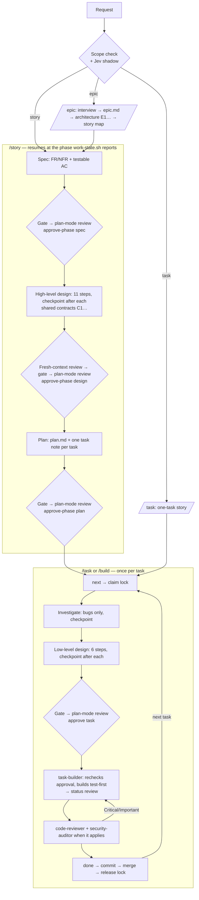

# Agent Skills

**Production-grade engineering skills for AI coding agents.**

Skills encode the workflows, quality gates, and best practices that senior engineers use when building software. These ones are packaged so AI agents follow them consistently across every phase of development.

> **This is a fork** of [addyosmani/agent-skills](https://github.com/addyosmani/agent-skills), maintained at [tung-dnt/agent-skills](https://github.com/tung-dnt/agent-skills). It adds:
> - design skills (`high-level-design`, `low-level-design`) that give each scope of work (epic, story, task) its own workflow
> - task notes in the Obsidian project-manager format, safe for parallel sessions, with git-lock claims and `/resume` after a closed session
> - a multi-agent `/build auto` that routes each piece of work to the cheapest model tier that can do it well
>
> See [What this fork adds](#what-this-fork-adds).

<a href="https://trendshift.io/repositories/25200" target="_blank"></a>


```
  DEFINE          PLAN           BUILD          VERIFY         REVIEW          SHIP
 ┌──────┐      ┌──────┐      ┌──────┐      ┌──────┐      ┌──────┐      ┌──────┐
 │ Idea │ ───▶ │ Spec │ ───▶ │ Code │ ───▶ │ Test │ ───▶ │  QA  │ ───▶ │  Go  │
 │Refine│      │  PRD │      │ Impl │      │Debug │      │ Gate │      │ Live │
 └──────┘      └──────┘      └──────┘      └──────┘      └──────┘      └──────┘
  /spec          /plan          /build        /test         /review       /ship
                              /resume
```

---

## Commands

14 slash commands that map to the development lifecycle. Each one activates the right skills automatically.

| What you're doing | Command | Key principle |
|-------------------|---------|---------------|
| Plan an epic or a new project | `/epic` | Intent, requirements, architecture, story map |
| Take a story to an approved plan | `/story` | Resumes at its current phase |
| Build one task end to end | `/task` | Claim → design note → your approval → subagents build and review |
| Stress-test a plan or decision | `/grill-me` | Settle every branch before acting |
| Define what to build | `/spec` | Spec before code |
| Plan how to build it | `/plan` | Small, atomic tasks |
| Build incrementally | `/build` | One slice at a time |
| Pick up after a closed session | `/resume` | State lives in files, not chat |
| Prove it works | `/test` | Tests are proof |
| Set the quality bar | `/constraints` | Decide it once, enforce it everywhere |
| Review before merge | `/review` | Improve code health |
| Audit web performance | `/webperf` | Measure before you optimize |
| Simplify the code | `/code-simplify` | Clarity over cleverness |
| Ship to production | `/ship` | Faster is safer |

In Claude Code these install as plugin commands. Where a built-in command has the same name, as `/review` does, use the namespaced form: `/agent-skills:review`.

Want fewer manual steps once the spec exists? **`/build auto`** generates the plan and implements every task in a single approved pass — you approve the plan once, then it runs autonomously. It removes the human stepping *between* tasks, not the verification: every task is still test-driven and committed individually, and it pauses on failures or risky steps.

Skills also activate automatically based on what you're doing — designing an API triggers `api-and-interface-design`, building UI triggers `frontend-ui-engineering`, and so on.

---

## What this fork adds

### A workflow for each scope of work

`/epic`, `/story`, and `/task` run these workflows. Every planning phase ends in a recorded approval, and nothing is built until `work-state.sh` confirms that approval still matches the files. They work with or without a tracker: a ticket key or URL is read as input, and without a tracker the repository's folders are the tracker.



| Phase | Command | Produces | Approval recorded as |
|---|---|---|---|
| Scope check | every command | epic, story, or task | Your confirmation when the scope looks wrong. Jev logs its guess but doesn't act on it |
| Epic | `/epic` | `epic.md`, `## Architecture` (`E1…`), story stubs | `summary.md`; its stories stay at phase `spec` until `/story` |
| Spec | `/story` | `spec.md` with `FR`/`NFR` ids | `spec_approved` in the story note's frontmatter |
| High-level design | `/story` | `## Design`, shared contracts `C1…` | `design_approved`, or recorded as skipped |
| Plan | `/story` | `plan.md` + `_tasks/*.md` | `plan_approved` (covers the plan and the list of task ids) |
| Task design | `/task` | the task's `## Design` (5–15 lines) | the task's `design_approved` (covers its description, design, and the text of each contract it cites) |
| Build | `task-builder` | code and tests, status `review` | — |
| Review → done | main session | `done`, merge, lock released | — |

**Every gate** ([references/approval-gate.md](references/approval-gate.md)):
1. A one-screen **catch-up summary** (Business context · Proposed fix fit · Root cause for bugs · Recommendation · Open decisions), saved to `[stories-dir]/[story-id]/summary.md` or the task note's `## Summary`.
2. **`grill-me` rounds** until nothing is open; each round is one `ask` dialog.
3. **In omp, a plan-mode review:** the agent asks you to turn plan mode on (Alt+Shift+P), submits the phase to omp's Plan Review, and your approval there (`keep`) is the go-ahead. `refine` sends it back with your feedback. Other hosts take the go-ahead as an answer to "Proceed?".
4. The go-ahead is **recorded** with `approve` / `approve-phase`.

Before the gate, `/story` and `/task` stop at a **step checkpoint** after the investigation and after every design step, so you approve the design piece by piece. `/build auto` and "don't stop" skip the checkpoints and pass one gate over every task design.

**What makes the tasks reliable:**
- **No building on a draft.** `phase` advances only on a recorded approval of an unchanged file. Editing an approved spec, design, or plan voids its approval.
- **No building on a stale contract.** Changing a contract voids every task design that cites it; `work-state.sh cites STORY C3` lists them so each goes through its gate again.
- **Checked twice.** The orchestrator runs `approved` before starting a builder, and the builder runs it again; if it fails, the builder reports `blocked`.
- **One owner per task.** The claim is a git lock (see below), so no two sessions, worktrees, or machines take the same task.
- **Safe parallel waves.** `/build auto` never puts two tasks that touch the same files in one wave; each task gets its own worktree.
- **Builder limits.** Test-first, commits only its own paths, never changes a shared contract, and stops with `blocked`, `failed`, or `needs-command` instead of guessing.
- **`done` means reviewed.** A task whose acceptance criteria pass goes to `review`; it is `done` only after code review (plus security review for auth or personal data) passes.
- **Resumable.** Status, `## Log` lines, claims, and worktrees are on disk; `/resume` rebuilds where each task stopped.
- **Measured before trusted.** An optional [Jev shadow pilot](hooks/JEV-SHADOW.md) logs TypeSafe Jev's answer at each checkpoint and scope check next to what actually happened, without acting on it, so a threshold for skipping checkpoints can be set from data (`jev.sh report`).

**Known weak spots:** a story stops about 13 times before planning and about 7 times per task, plus a keypress per plan-mode review; plan mode can only be turned on by you; an epic's approval lives only in its `summary.md`.

### Work state, parallel sessions, and `/build auto`

Story and task notes live in your Obsidian vault (or `docs/stories` in the repo), claims are git locks so parallel sessions and machines never take the same task, `/resume` rebuilds where work stopped, and `/build auto` runs task builders in parallel worktrees on the cheapest model tier that can do the job. Details: **[docs/work-state-and-parallel-builds.md](docs/work-state-and-parallel-builds.md)** and [references/work-artifacts.md](references/work-artifacts.md).

---

## Quick Start

**Fastest path — any agent, one command.** The open [skills CLI](https://github.com/vercel-labs/skills) installs into 70+ agents (Claude Code, Cursor, Codex, Copilot, Cline, and more):

```bash
npx skills add tung-dnt/agent-skills            # install all 28 skills
npx skills add tung-dnt/agent-skills --list     # browse before installing
```

Or grab individual skills:

```bash
npx skills add tung-dnt/agent-skills --skill code-review-and-quality   # five-axis review before merge
npx skills add tung-dnt/agent-skills --skill interview-me              # requirements interrogation, one question at a time
npx skills add tung-dnt/agent-skills --skill test-driven-development   # red-green-refactor, enforced
```

> **Installing one skill?** A per-skill `npx` install copies only
> `skills/<name>/`, not the repo-level `references/` directory. The skill still
> works, but paths to supplementary shared checklists are unavailable, and so is
> `hooks/work-state.sh` (the reference describes the manual git fallback). Use a
> whole-repo integration, clone the repository, or copy the needed checklist into
> a `references/` directory inside the installed skill. This portability gap is
> tracked in [#361](https://github.com/addyosmani/agent-skills/issues/361).

Prefer a native integration? Pick your tool below.

<details>
<summary><b>Claude Code (recommended)</b></summary>

**Marketplace install:**

```
/plugin marketplace add tung-dnt/agent-skills
/plugin install agent-skills@tung-agent-skills
```

**Updating:** the plugin version stays in step with upstream (0.6.x), so `/plugin update` can report "already at the latest version" after new commits. Reinstall to pick them up:

```bash
claude plugin marketplace update tung-agent-skills
claude plugin uninstall agent-skills@tung-agent-skills
claude plugin install agent-skills@tung-agent-skills
```

> **SSH errors?** The marketplace clones repos via SSH. If you don't have SSH keys set up on GitHub, either [add your SSH key](https://docs.github.com/en/authentication/connecting-to-github-with-ssh/adding-a-new-ssh-key-to-your-github-account) or use the full HTTPS URL to force HTTPS cloning during the marketplace-add step:
> ```bash
> /plugin marketplace add https://github.com/tung-dnt/agent-skills.git
> /plugin install agent-skills@tung-agent-skills
> ```
>
> If `/plugin install` still fails with `git@github.com: Permission denied (publickey)` on Windows or macOS, the recommended workaround is to configure Git once to rewrite GitHub SSH URLs to HTTPS for subprocess clones:
> ```bash
> git config --global url."https://github.com/".insteadOf git@github.com:
> ```

**Local / development:**

```bash
git clone https://github.com/tung-dnt/agent-skills.git
claude --plugin-dir /path/to/agent-skills
```

</details>

<details>
<summary><b>Cursor</b></summary>

Put workflow skills under `.cursor/skills/` (sync from `agent-skills/skills/`) and short policies in `.cursor/rules/*.mdc` — do not paste full skills into rules. Both directories live in your project; this repo does not ship a `.cursor/` folder. See [docs/cursor-setup.md](docs/cursor-setup.md).

</details>

<details>
<summary><b>Antigravity CLI</b></summary>

Install as a native plugin for skills and subagents. In affected Antigravity CLI releases, legacy command TOMLs are reported as converted but their wrapper commands are not discoverable; invoke the underlying namespaced skills directly. See [docs/antigravity-setup.md](docs/antigravity-setup.md#lifecycle-workflows-and-command-compatibility).

**Install from the repo:**

```bash
agy plugin install https://github.com/tung-dnt/agent-skills.git
```

**Install from a local clone:**

```bash
git clone https://github.com/tung-dnt/agent-skills.git
agy plugin install ./agent-skills
```

</details>

<details>
<summary><b>Gemini CLI</b></summary>

Install as native skills for auto-discovery, or add to `GEMINI.md` for persistent context. See [docs/gemini-cli-setup.md](docs/gemini-cli-setup.md).

**Install from the repo:**

```bash
gemini skills install https://github.com/tung-dnt/agent-skills.git --path skills
```

**Install from a local clone:**

```bash
gemini skills install ./agent-skills/skills/
```

</details>

<details>
<summary><b>Windsurf</b></summary>

Add skill contents to your Windsurf rules configuration. See [docs/windsurf-setup.md](docs/windsurf-setup.md).

</details>

<details>
<summary><b>OpenCode</b></summary>

Copy skills to `.opencode/skills/` (or `~/.config/opencode/skills/`), add a project-local `AGENTS.md`, and use the built-in `skill` tool for agent-driven execution. Optional slash commands can be added under `.opencode/commands/`.

See [docs/opencode-setup.md](docs/opencode-setup.md).

</details>

<details>
<summary><b>GitHub Copilot</b></summary>

Use agent definitions from `agents/` as Copilot personas and skill content in `.github/copilot-instructions.md`. The lifecycle slash commands (`/spec`, `/plan`, `/build`, `/test`, `/review`, `/ship`) are Claude Code commands and do not appear in Copilot; invoke the skills by name (`/spec-driven-development`, …) instead. See [docs/copilot-setup.md](docs/copilot-setup.md).

Using the standalone `copilot` CLI? Install it as a plugin — see [docs/copilot-cli-setup.md](docs/copilot-cli-setup.md).

</details>

<details>
  <summary><b>Kiro IDE & CLI </b></summary>
  Skills for Kiro reside under ".kiro/skills/" and can be stored under Project or Global level. Kiro also supports Agents.md. See Kiro docs at https://kiro.dev/docs/skills/
</details>

<details>
<summary><b>Codex</b></summary>

Install as a native Codex plugin (Codex CLI v0.122+):

```bash
codex plugin marketplace add tung-dnt/agent-skills
codex plugin add agent-skills@agent-skills
```

The first command registers the marketplace; the second installs the plugin. Codex reads the root `skills/` directory directly through `.codex-plugin/plugin.json`. Once installed, invoke skills in chat using `@` (e.g., `@spec-driven-development`). See [docs/codex-setup.md](docs/codex-setup.md) for local installation and troubleshooting.

</details>

<details>
<summary><b>Command Code</b></summary>

Install natively with the built-in `cmd skills` command. Command Code clones the repo, discovers every `SKILL.md`, and installs into `.commandcode/skills/`:

```bash
cmd skills add tung-dnt/agent-skills            # pick skills to install (project)
cmd skills add tung-dnt/agent-skills --global   # install for all projects (~/.commandcode/skills/)
cmd skills add tung-dnt/agent-skills -s spec-driven-development  # install a specific skill
```

Installed skills show up in the TUI slash menu, e.g. `/spec-driven-development`. See [docs/commandcode-setup.md](docs/commandcode-setup.md).

</details>

<details>
<summary><b>Other Agents</b></summary>

Skills are plain Markdown - they work with any agent that accepts system prompts or instruction files. See [docs/getting-started.md](docs/getting-started.md). Hosts that install the pack but aren't listed above are in [docs/other-hosts.md](docs/other-hosts.md).

</details>


---

## Adoption

Already installed? How you roll the pack out depends on your codebase. The **[Adoption Guide](docs/adoption-guide.md)** covers two paths: the full lifecycle from day one for a greenfield project, or an incremental, verification-first rollout for an established codebase.

---

## Skills, Personas, and Checklists

The pack includes 28 skills (27 lifecycle skills plus the `using-agent-skills` meta-skill), 6 agent personas, and the shared reference checklists. Full catalog: **[docs/skills-catalog.md](docs/skills-catalog.md)**.

---

## How Skills Work

Each skill is a step-by-step workflow with verification gates and anti-rationalization tables. How they are structured and loaded, the project layout, and why they exist: **[docs/how-skills-work.md](docs/how-skills-work.md)**.

---

## How it compares

Wondering how this stacks up against [Superpowers](https://github.com/obra/superpowers) or [Matt Pocock's skills](https://github.com/mattpocock/skills)? See **[docs/comparison.md](docs/comparison.md)** for an honest, side-by-side look at how the three are shaped differently and when to reach for each — including a link to a controlled [head-to-head experiment](https://www.linkedin.com/pulse/superpowers-vs-agent-skills-faster-shipping-safer-reasoning-om-mishra-dzakf/).

---

## Contributing

Skills should be **specific** (actionable steps, not vague advice), **verifiable** (clear exit criteria with evidence requirements), **battle-tested** (based on real workflows), and **minimal** (only what's needed to guide the agent).

See [docs/skill-anatomy.md](docs/skill-anatomy.md) for the format specification, [CONTRIBUTING.md](CONTRIBUTING.md) for guidelines, and [docs/advanced-per-agent-configuration.md](docs/advanced-per-agent-configuration.md) for applying model routing, tool restrictions, and other per-agent runtime controls without breaking the portable `SKILL.md` frontmatter.

---

## Team

agent-skills is built and maintained by:

| | Name | GitHub | Role |
|---|------|--------|------|
|  | **Addy Osmani** | [@addyosmani](https://github.com/addyosmani) | Creator |
|  | **Federico Bartoli** | [@federicobartoli](https://github.com/federicobartoli) | Collaborator |
|  | **Joan León** | [@nucliweb](https://github.com/nucliweb) | Collaborator |

This fork is maintained by [@tung-dnt](https://github.com/tung-dnt).

---

## License

MIT - use these skills in your projects, teams, and tools.
