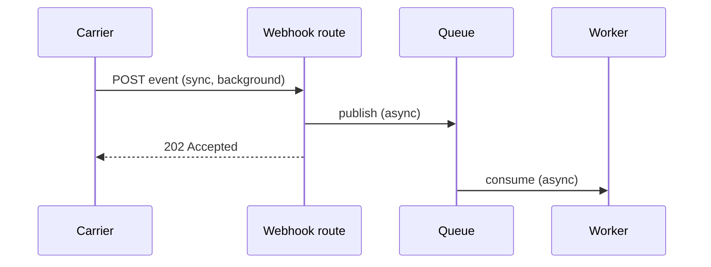

# High-Level Design

## Overview

Requirements decide what the system must do. High-level design decides the shape that will meet them and fixes decisions shared by multiple implementation tasks. Without it, each task silently chooses its own APIs, data ownership, lifecycle, and failure behavior.

The design has two layers:
- **Shape:** components, flows, data ownership, and how each non-functional requirement is met.
- **Shared contracts:** APIs, schema, status lifecycles, and failure policies used by more than one task.

Task-local functions and edge cases belong in `low-level-design`. Static design artifacts are handed to workers by path; they never serve as mutable task-status stores.

## When to Use

- Requirements are approved and task planning has not started.
- The change adds/reshapes a component, service, data store, integration, queue, or shared boundary.
- More than one task depends on a common API, table, status field, or event stream.
- An epic needs architecture before stories are split.

Do not design against unclear requirements; use `spec-driven-development` first. A change inside one existing module with no shared contract may skip high-level design only after the user explicitly agrees. A single interface surface belongs in `api-and-interface-design`.

## Process

Work top-down. Follow the checkpoints in `../../references/approval-gate.md`: pause after steps 1, 5, and 9 unless the user explicitly requested a one-pass design. A one-pass request never skips the final user approval. Show each result, ask any decision as soon as it arises, and wait before relying on it.

### 1. Load inputs and current architecture

- Read approved requirements and assign stable `FR` and `NFR` IDs where missing.
- Read `CONSTRAINTS.md` and the existing architecture/ADRs if present.
- Read the components, data stores, and integrations the change will touch; extend existing patterns before proposing new ones.
- Use an approved epic/architecture artifact supplied by the main session where relevant. Cite its shared contract IDs rather than copying or contradicting them.
- For a large unfamiliar codebase, delegate a read-only summary and keep exact source paths in the design.

### 2. Scope

Name what the design includes and explicitly excludes, plus stakeholders who must accept it. Add a small context diagram showing the system, users, and external systems.

### 3. Components and responsibilities

List each new or modified component and the responsibility/data it owns. Prefer extending an existing component when it can do the job; explain why a new component is justified.

### 4. Flows

Show important flows as sequence diagrams. Label each hop sync or async and each flow critical-path or background. Include the happy path and only failure paths that affect the design; task-local edge cases belong in LLD.



### 5. Data ownership

For each entity: identify its writer/owner, readers and access path, retention/privacy rules, and migration strategy. Put column-level detail in a shared contract only when multiple tasks depend on it.

### 6. NFR mechanisms

For each NFR, state the concrete mechanism and how it will be verified. A target with no mechanism is not a complete design.

| NFR | Target | Mechanism | Verification |
|---|---|---|---|
| NFR1 | p95 read < 200 ms | Cache keyed by order id, invalidated by worker | Load test |
| NFR2 | No cross-account reads | Ownership check in handler | Negative test across accounts |

### 7. Integrations and consistency

For each external/cross-component call, decide timeout, retry/backoff, circuit breaking where needed, and strong/eventual consistency. If data is eventual, specify maximum staleness and what the user sees.

### 8. Security and compliance

Identify authentication and authorization points, tenant/ownership checks, trust boundaries, encryption, sensitive data, and fields that must never be logged. Use `security-and-hardening` for untrusted inputs or sensitive data.

### 9. Deployment and rollout

State environments and relevant differences, deployment models, CI/CD shape, feature flags, migration order (expand → deploy → contract), and staged rollout if warranted. `shipping-and-launch` owns the full launch checklist.

### 10. Shared contracts

Record a contract only when at least two tasks depend on it; a single-task detail belongs in LLD. Give each shared contract a stable ID `C1`, `C2`, … (or cite the approved epic `E` contract). Include concrete examples for:
- API method/path/request/response and error behavior.
- Schema types/nullability, constraints, and index rationale.
- Status transitions, terminal states, and invalid-transition behavior.
- Shared failure policy: idempotency, retries/backoff, dead letters, and partial-write behavior.

### 11. Alternatives and decisions

For decisions expensive to reverse, compare at least two viable options against requirements/NFRs, effort, risk, and reversibility. Present the hinges and the condition that would change the recommendation as a decision brief. Record durable decisions with `documentation-and-adrs` where the repository's ADR convention applies.

### 12. Adversarial review and user approval

Run `doubt-driven-development` in a fresh context against the approved spec: find requirements with no design, NFRs without a mechanism, and unowned failure paths. Resolve findings, then pass the user gate in `../../references/approval-gate.md`. The user must explicitly approve before task planning. No native todo item, worker status, or artifact path is approval.

## Output

Write a static design artifact at the path supplied by the main session/user or the repository's established architecture convention. It can be a `## Design` section in a story spec, a standalone `design.md`, or an epic architecture artifact. Do not assume a specific project store or task-note path.

```markdown
## Design

### Scope
In: … | Out: … | Stakeholders: …

### Components
| Component | Change | Owns | Serves |

### Flows
Sequence diagrams; sync/async and critical/background labels

### Data
| Entity | Owner | Readers | Retention | Migration |

### NFR mechanisms
| NFR | Target | Mechanism | Verification |

### Integrations
| Dependency | Timeout | Retry/backoff | Consistency |

### Security
AuthN/AuthZ, trust boundaries, sensitive fields

### Deployment and rollout
Environments, deployment model, CI/CD, flags, migration/rollout

### Shared contracts
#### C1 <Contract name>
Concrete contract details and examples

### Decisions
Alternatives, recommendation, ADR links
```

Trace each design element to one or more `FR`/`NFR` IDs; anything tracing to nothing is potential scope creep. The artifact is static approved context for worker briefs, not live task progress.

## Keep design aligned

When implementation proves the design wrong, stop affected work and use the user gate to approve a revised design. Update the static artifact and affected worker briefs before resuming; main owns ordering and file reassignment. Do not use a task-status board to discover dependents. The repository's current system architecture should be updated using its existing convention when the system shape changes.

Before the final implementation change is merged, update the repository's current system-architecture document with the approved shape, ownership, flows, security boundaries, and rollout. Keep shared-contract detail in its authoritative design artifact and link it rather than duplicating it. After a contract changes, the main session identifies every affected task and obtains fresh approval before that task resumes; a previous task approval does not cover revised contract text.

## Common Rationalizations

| Rationalization | Reality |
|---|---|
| “The architecture is obvious.” | Record it so separate tasks do not make incompatible choices. |
| “The NFR target is enough.” | A target without a mechanism and verification is unmet. |
| “An implementer can decide the failure path.” | Shared failure behavior must be settled before dependent tasks start. |
| “The old task approval still applies.” | Changed shared contracts require review of affected tasks and fresh approval. |

## Red Flags

- A component, flow, or contract has no requirement it serves.
- Several writers own the same data without a consistency rule.
- A shared lifecycle omits invalid transitions or terminal states.
- Security, failure ownership, or NFR verification is deferred to implementation.
- Code diverges from the approved design or the repository architecture stays stale.

## Verification

- [ ] Every requirement maps to a design element and every element traces to a requirement.
- [ ] Scope and out-of-scope are explicit.
- [ ] Every flow hop is sync/async and each flow is critical/background.
- [ ] Every NFR has a mechanism and verification.
- [ ] Data ownership, readers, retention, and migration are clear.
- [ ] Shared contracts have stable IDs and concrete examples; status rules include invalid transitions.
- [ ] Alternatives and expensive-to-reverse decisions were examined.
- [ ] Security, deployment, rollout, and failure ownership are explicit.
- [ ] Fresh-context doubt review findings are resolved.
- [ ] The user approved the design before planning.
- [ ] The static artifact and task briefs do not duplicate mutable progress.